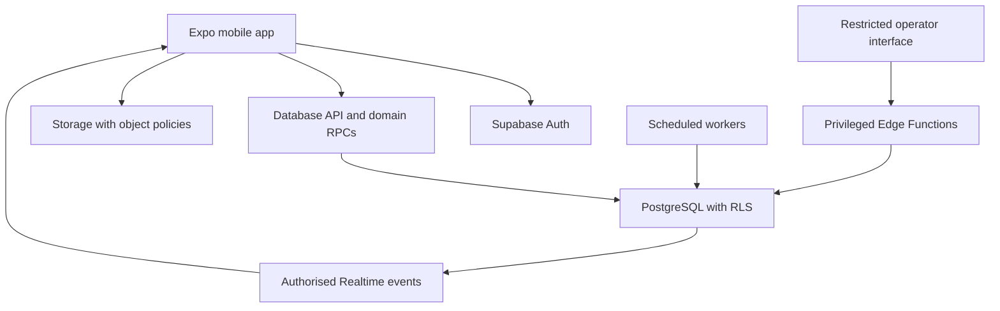
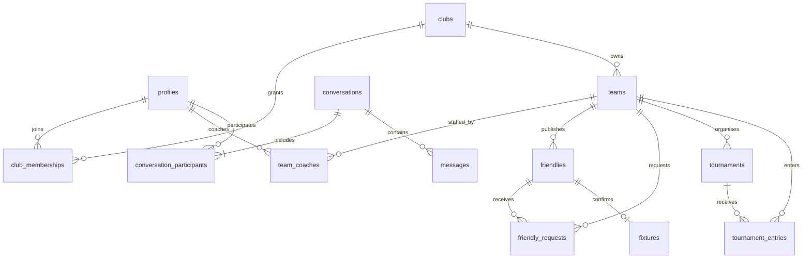

# MatchUp — Technical Architecture

Version: 1.0 | Date: 15 October 2026 | Status: Proposed implementation baseline

## 1. Scope and decisions

This architecture implements [PRD.md](PRD.md) for a football-only mobile MVP. It is a design specification, not an audit of existing code. React Native with Expo, TypeScript, NativeWind and Supabase are fixed inputs. Dependency versions, hosting region and service-plan capabilities must be verified and pinned during implementation; no latest-version claims are made here.

The system is a modular monolith: a feature-based mobile application plus a single PostgreSQL source of truth. Supabase provides Auth, PostgreSQL APIs, Storage and Realtime. Database transactions own invariants; clients own presentation and request orchestration. Edge Functions handle privileged integrations and operator endpoints, never replace transactional integrity with a chain of network writes.

### Architectural decisions

| ID | Decision | Reason / trade-off |
| --- | --- | --- |
| ADR-01 | Relational PostgreSQL model and migrations first | Transactions and explicit constraints fit shared club/team data |
| ADR-02 | Team belongs to club; coach/team many-to-many via team_coaches | Teams survive coach turnover and support shared responsibility |
| ADR-03 | Club-scoped membership plus separate team assignments | Club administration does not accidentally grant authority over every team's matches |
| ADR-04 | RLS for reads; named transactional commands for domain mutations | Consistent checks across mobile, scripts and operator tools |
| ADR-05 | Realtime signals followed by canonical refetch | Connections may miss or duplicate events; database remains authoritative |
| ADR-06 | Text-only, event-linked two-person conversations | Bounded MVP; explicit privacy and handover rules |
| ADR-07 | Separate commitment ledger for schedule conflicts | One mechanism prevents friendly/tournament overlap races |
| ADR-08 | No custom general-purpose API server at launch | Lower operational overhead; revisit only with measured need |

## 2. Components and trust boundaries



Mobile and operator interfaces are untrusted inputs. Publishable client configuration is not an authorisation boundary. Service-role credentials exist only in controlled server environments. Every database/storage/realtime path enforces authority independently of UI visibility. No arbitrary client-supplied actor ID is trusted.

The operator interface is a separate restricted surface, not a public admin tab. Its exact UI framework is an implementation choice; authentication, MFA, least privilege and auditable commands are mandatory.

## 3. Mobile code organisation

```text
app/                         # Expo Router routes and navigation only
src/
  features/
    auth/
    clubs/
    teams/
    friendlies/
    tournaments/
    messaging/
    activity/
    profile/
  components/ui/             # Accessible reusable primitives
  lib/                       # Supabase client, configuration, observability
  hooks/                     # Cross-feature hooks only
  types/database.generated.ts
  theme/
supabase/
  migrations/
  functions/
  tests/
  seed.sql                   # Synthetic development data
```

Each feature contains components, typed query/command adapters, validation schemas, hooks and tests. Routes compose features; UI components do not issue ad hoc SQL/API operations. Use a server-state cache such as TanStack Query, schema validation such as Zod, and a form library where useful; these are proposed additions, not fixed requirements from the brief. Keep ephemeral UI state local. Do not duplicate authoritative permissions or domain states in a global client store.

Generate database types from migrations. Narrow RPC return types and error unions at the adapter boundary. Validate environment configuration at startup. Use a consistent date/time abstraction that preserves IANA timezone plus UTC timestamps. Persist sessions using platform-appropriate protected storage; review token storage against the selected SDK and device threat model. Clear private cache and subscriptions on logout/account switch.

## 4. Relational data model

The original profiles → clubs → teams → friendlies → tournaments → conversations → messages sequence is not a foreign-key chain. Friendlies and tournaments are independent event domains, and coaches belong to teams through a join table.



### Schema conventions

UUID primary keys; `timestamptz` for instants; IANA timezone text for event presentation; server-generated `created_at`/`updated_at`; integer `version` on mutable aggregates for optimistic concurrency. Use controlled enum/check values for states. All operational foreign keys indexed. Use `ON DELETE RESTRICT` on clubs, teams, events and history; lifecycle commands perform archival/anonymisation. Deleting an auth identity must follow the account-deletion workflow rather than cascading through fixtures or messages.

### Core tables

| Table | Required fields and constraints |
| --- | --- |
| profiles | id references auth.users; display_name; avatar_path nullable; eligibility_declared_at; account_status; active_team_id nullable; no editable platform-role field |
| clubs | id; name; normalised_name; town; region; country_code; description; logo_path; claim_status; lifecycle_status; created_by; version |
| club_memberships | id; club_id; profile_id; role owner/admin/coach; status; requested_at; decided_by/at; UNIQUE(club_id, profile_id) |
| teams | id; club_id; name; age_band; category; format; level; season; lifecycle_status; version; UNIQUE(club_id, normalised_name, season) |
| team_coaches | id; team_id; profile_id; status pending/approved/rejected/withdrawn/removed; requested_at; decided_by/at; UNIQUE(team_id, profile_id); linked club membership must be approved for approved assignment |
| club_invitations | id; club_id; optional team_id; normalised_email; token_hash unique; invited_role; invited_by; expires_at; accepted_at; revoked_at; no raw token storage |
| friendlies | id; team_id; created_by; starts_at; ends_at; timezone; age_band; category; format; level; venue_preference; search_location; notes; indicative_cost_minor nullable; currency; status; version |
| friendly_requests | id; friendly_id; requesting_team_id; requested_by; note; proposed_venue_id nullable; status; decided_by/at; UNIQUE(friendly_id, requesting_team_id) |
| fixtures | id; friendly_id UNIQUE; accepted_request_id UNIQUE; host_team_id; opponent_team_id; starts_at; ends_at; timezone; venue_id; status; cancelled_by/at/reason; CHECK(host_team_id <> opponent_team_id) |
| tournaments | id; organiser_team_id; created_by; title; venue_id; starts_at; ends_at; timezone; entry_deadline; age_band; category; format; capacity; entry_information; indicative_fee_minor nullable; currency; status; version |
| tournament_entries | id; tournament_id; team_id; requested_by; status; decided_by/at; UNIQUE(tournament_id, team_id) |
| venues | id; owning_club_id; label; address; exact_point; public_town; public_search_point; visibility policy; version |
| team_commitments | id; team_id; fixture_id nullable; tournament_entry_id nullable; occupied_range tstzrange; active boolean; exactly one source FK populated; UNIQUE(team_id, fixture_id); UNIQUE(tournament_entry_id) |
| conversations | id; friendly_request_id nullable; tournament_entry_id nullable; status; writable_until; exactly one context FK populated; UNIQUE(friendly_request_id); UNIQUE(tournament_entry_id) |
| conversation_participants | id; conversation_id; profile_id; represented_team_id; joined_at; revoked_at nullable; last_read_sequence; UNIQUE active participant per conversation/team and per conversation/profile |
| messages | id; conversation_id; sender_id; client_message_id; sequence bigint; body; created_at; moderation_status; UNIQUE(sender_id, client_message_id); UNIQUE(conversation_id, sequence) |
| activity_items | id; recipient_id; event_key; type; resource_id; safe_payload; read_at; created_at; UNIQUE(recipient_id, event_key) |
| user_blocks | blocker_id; blocked_id; created_at; composite PK; CHECK(blocker_id <> blocked_id) |
| reports | id; reporter_id; target_type; target_id; reason_code; status; assigned_operator; timestamps; referenced evidence snapshot in restricted store |
| audit_events | id; actor_id nullable; actor_kind; action; resource_type/id; correlation_id; safe before/after diff; created_at; append-only |
| outbox_events | id; aggregate_type/id; event_type; payload; deduplication_key UNIQUE; created_at; attempts; available_at; processed_at |
| idempotency_keys | actor_id; command_name; key; request_hash; result JSON; created_at; expires_at; UNIQUE(actor_id, command_name, key) |
| platform_admins | profile_id; scoped privileges; active; provisioned through restricted operational process only |

`team_coaches` represents team-level access and its request state. A pending club membership can exist alongside pending assignments. Approval of a team request atomically approves the necessary club coach membership; a club membership alone grants no team powers. Removing club membership revokes every team assignment in that club in the same transaction.

### Integrity beyond foreign keys

- Validate team/club consistency for invitations, assignments and conversation representation using transactional functions and constraint triggers where a cross-table invariant cannot be expressed by FK.
- `active_team_id` is a preference; it never grants permission. Removal clears it if it references the removed assignment.
- Enforce `ends_at > starts_at`, positive capacity, valid deadlines, non-negative fees and ISO currency values through database constraints/configuration.
- Restrict event fields and lifecycle updates to command functions. Enforce fixture teams/request correspondence and tournament entry eligibility server-side.
- Require exactly two active conversation participants representing the two relevant teams, created atomically. The organiser team cannot enter its own tournament; same-club tournament entries are allowed for different eligible teams. Same-club friendlies are excluded by PRD.
- Age/category/format compatibility uses a versioned configuration table shared by search and commands; default is exact match. Persist eligibility snapshots to prevent later team edits rewriting event terms.
- Disallow direct mobile updates to roles, statuses, commitment rows, counters and audit/outbox tables.

### Schedule exclusion

Enable `btree_gist` if available in the selected project and add a GiST exclusion constraint on `(team_id WITH =, occupied_range WITH &&) WHERE (active)`. Use half-open `[start,end)` ranges so back-to-back events are permitted. Fixtures add commitments for both teams; approved tournament entries add one for the entering team covering the entire tournament. The organising team has no automatic playing reservation unless an explicitly supported future participation workflow is added.

Only commands create/release commitments. Cancellation sets active=false in the same transaction. Concurrent overlapping confirmations fail at the database boundary even when they concern unrelated listings. If the required extension is unavailable, block launch until an equivalent, proven team-lock strategy is selected and concurrency-tested; do not silently omit conflict prevention.

## 5. Authorisation model

RLS is enabled on every exposed table, including join tables, activity and message tables. Default access is denied. Public/anonymous users receive no MVP domain data. Use curated discovery projections/RPC results that omit exact addresses, emails and internal IDs where unnecessary. Do not accidentally bypass RLS through owner-executed views; use an appropriately secured projection and test its effective permissions.

| Resource | Read | Mutate |
| --- | --- | --- |
| Discovery club/team summaries | Verified active users; safe fields only | Club metadata by owner/admin; team sporting fields by assigned coach/admin |
| Membership and invitations | Self and relevant club admins; tokens never returned | Requester withdrawal; admin approve/reject/invite; owner-only elevated role commands |
| Open listings/tournaments | Verified active users; approximate venue | Assigned organiser-team coaches through domain commands |
| Requests, fixtures and entries | Relevant approved team coaches; scoped admin operational summaries | Represented team/organiser coaches through domain commands |
| Conversations/messages | Explicit active participants who still have represented-team authority | Eligible participant; block, suspension and writable window checked on each send |
| Activity | Recipient only | Server creates; recipient marks read |
| Reports and evidence | Reporter sees limited own status; assigned authorised moderators see evidence | Report command or restricted moderation command |
| Audit/outbox/admin tables | Restricted operational roles | Trusted functions/jobs only |

RLS helper functions resolve current memberships from database records, not user-editable JWT metadata. Avoid recursive policies through narrowly scoped helpers with explicit grants. `SECURITY DEFINER` functions use a fixed safe `search_path`, fully qualified objects, no untrusted dynamic SQL and an explicit `auth.uid()`/role check; revoke default public execute and grant only the intended callers. Ordinary functions remain invoker-security when possible. Elevated server credentials bypass RLS, so privileged endpoints must perform their own equivalent authorisation and audit.

Member revocation is enforced by live database checks even if an access token remains valid. Remove corresponding realtime subscriptions and clear affected caches when a membership event arrives; because a stale socket may persist, private message bodies are never broadcast directly. Broadcast only opaque conversation-change signals and refetch under current RLS. Validate the chosen Realtime topic policy and revocation behaviour in integration tests.

## 6. Command and query contracts

Clients use read-only filtered queries for simple scoped reads and RPCs for geospatial discovery/complex projections. Domain writes are transactional RPCs; Edge Functions authenticate and call these when external dependencies or operator controls are required.

| Command | Key input | Atomic result |
| --- | --- | --- |
| create_club | club data, idempotency key | Club plus owner membership |
| request_team_access | team IDs, key | Pending membership/assignment rows |
| approve_team_access | assignment ID, expected version, key | Club membership and assignment approved; activity/outbox |
| accept_club_invitation | raw token, key | Token consumed and scoped membership/assignment created |
| remove_club_member | membership ID, key | Assignment revocation, active-team reset and conversation revocation |
| publish_friendly | listing ID/data, version, key | Valid open listing |
| request_friendly | friendly ID, representing team, note/venue, key | Pending request plus contextual conversation |
| accept_friendly_request | request ID, version, key | Fixture, commitments, listing closure, other-request declines and activity |
| cancel_fixture | fixture ID, reason, version, key | Cancelled fixture and released commitments |
| publish_tournament | draft ID/data, version, key | Published tournament |
| request_tournament_entry | tournament/team IDs, key | Pending entry plus conversation |
| approve_tournament_entry | entry ID, version, key | Approved entry, commitment, activity |
| cancel_tournament | tournament ID, reason, version, key | Cancelled event/entries and released commitments |
| send_message | conversation ID, client_message_id, text | One durable message; sequence and timestamp |
| mark_conversation_read | conversation ID, last seen sequence | Monotonic read cursor capped to visible persisted messages |
| report_content / block_user | target/reason or blocked account, key | Restricted evidence/report or block |

Also implement explicit decline, withdraw, entry cancellation, draft editing, team archival, invitation revocation, ownership transfer and handover commands using the same pattern. Do not expose generic status-update RPCs.

Return typed responses: success with canonical resource/version, or `UNAUTHENTICATED`, `FORBIDDEN`, `VALIDATION_ERROR`, `NOT_FOUND`, `CONFLICT`, `CAPACITY_REACHED`, `SCHEDULE_CONFLICT`, `RATE_LIMITED`, `TEMPORARILY_UNAVAILABLE`. Do not reveal whether a private inaccessible resource exists. Include a correlation ID; never return SQL internals or tokens. Queries use stable cursor pagination with a deterministic ID tie-breaker, default 20 and maximum 100 rows.

All retryable write commands take a client-generated UUID idempotency key. Persist the request hash and result in the domain transaction; reuse with a changed payload is rejected. Keep keys for at least 72 hours and retain longer-lived uniqueness on domain records. Message IDs remain unique for the full message retention period. Retry transient network errors with capped exponential backoff and jitter; never auto-retry a permission or validation failure.

## 7. Transaction algorithms

### Friendly acceptance

1. Authenticate; verify verified active account and approved host-team assignment.
2. Claim/check idempotency key; lock the listing. Read the selected request as a candidate; recheck listing status/version, future time and immutable eligibility snapshot.
3. Confirm request is pending and opposing team is active. Validate final agreed venue and requester authority at the time of request/acceptance.
4. Lock affected teams in sorted UUID order, then lock/revalidate the selected request and affected dependent rows; insert fixture and both commitments. Exclusion constraint rejects conflicts.
5. Mark listing matched, selected request accepted and other pending requests declined. Insert activity/audit/outbox events.
6. Commit once. Any exception rolls everything back; translate uniqueness/exclusion failures into typed conflicts. Return the existing result on exact replay.

### Tournament approval

Lock tournament, then participating team, then entry using the global lock order. Recheck published status, deadline, eligibility and active assignment. Count approved entries under the tournament lock; reject if at capacity. Insert commitment, approve entry and emit durable events in one transaction. Every approval, entry cancellation and capacity change must lock the same tournament row. Capacity is not enforced by an unsafe client count.

### Membership removal and archival

Lock club/membership/team resources in documented global order. Check last-owner/final-coach restrictions. Revoke related assignments and conversation access, clear invalid preferences and write audit/activity records atomically. If future commitments would be orphaned, reject with the required reassignment/cancellation actions. Do not silently delete event history.

### Locking discipline

For commands spanning domains, acquire club locks if needed, then event aggregates sorted by type/ID, then team rows sorted by ID, then dependent rows. Publish the exact lock order in code comments and integration tests; reconcile the per-command steps with that order during implementation. Treat deadlocks/serialization failures as bounded retryable failures with idempotency, not partial success.

## 8. Messaging and realtime

`send_message` validates active account, current team authority, active participant status, conversation window and blocks in either direction. Trim and validate text server-side (proposed maximum 4,000 characters), allocate a monotonic per-conversation sequence under a conversation lock, insert once and commit before signalling change. Store plain text and render without HTML interpretation.

Clients subscribe only to authorised opaque change signals; fetch message pages using `(sequence,id)` and merge by message ID. Reconnect performs a cursor-based catch-up and inbox refetch. Sequence allocation is server-side; device timestamps do not order messages. Read cursors use `greatest(previous,new)` after visibility validation.

Handover revokes the prior participant and activates a replacement atomically after acceptance, recording consent/disclosure and an audit event. Future access is always checked against current assignments. Cancellation leaves history readable while participants remain authorised; writable_until controls sending. Background delivery and push are outside MVP, so do not promise immediate responses while the app is closed.

## 9. Search, location and indexes

Use PostgreSQL/PostGIS geography points for approximate search where supported. Index search geography with GiST and filter on distance in metres; return approximate distance, not private coordinates. Device location is optional and need not be persisted. Resolve manually entered towns via a selected geocoding provider/server integration; provider selection and terms remain an implementation decision. Store exact venue coordinates separately with stricter access.

Initial indexes: memberships `(profile_id,status)` and `(club_id,status)`; assignments `(profile_id,status)` and `(team_id,status)`; friendlies `(status,starts_at,id)` plus eligibility filters and spatial index; requests `(friendly_id,status)`; tournaments `(status,starts_at,id)` and spatial venue projection; entries `(tournament_id,status)`; messages `(conversation_id,sequence DESC)`; activity `(recipient_id,created_at DESC,id)` with unread partial index; outbox `(available_at)` WHERE unprocessed. Inspect real query plans before adding wider composite indexes.

Use SQL pagination, never download all listings to filter on-device. Escape/parameterise search input, cap radius/date range and use a configurable text-search minimum. Search is advisory; command eligibility is authoritative.

## 10. Files and external integrations

Storage contains optional coach avatars and club logos only; no message attachments in MVP. Use private buckets and short-lived authorised URLs. Authorise object keys by owner/club membership and disallow arbitrary overwrites. Proposed limits: 5 MiB and JPEG/PNG/WebP; verify actual bytes, dimensions and decoded type, strip metadata, reject malformed images and promote validated derivatives from a private staging area. Clean orphan uploads with a delayed job; database rows store object paths, not signed URLs.

Email provider delivers auth and invitations through controlled templates; no email address in analytics. Geocoding, error monitoring and store distribution are the only additional integration categories assumed. Secrets remain server-side. Redact credentials, email links, exact location and chat text from logs.

## 11. Jobs, outbox and failure recovery

Database time drives listing expiry, completion, invitation expiry, conversation closure, retention cleanup and outbox dispatch. State transitions are conditional and idempotent. An expiry job reconciles missed executions on its next run.

Business transactions write outbox events with unique domain keys. Workers claim batches with `FOR UPDATE SKIP LOCKED`, mark leased work, retry with backoff, and dead-letter after a configured attempt threshold with an alert. Use a lease expiry for crashed workers. Delivery is at least once; consumers deduplicate. In-app activity can be created in the originating transaction; realtime signals and analytics may be asynchronous and must never determine whether a booking succeeded.

Large tournament cancellations must remain atomic for entries/commitments; cap pilot event capacity to a tested bound (proposed 128 teams). Notifications may fan out asynchronously through idempotent outbox consumers. If scale exceeds the tested transaction bound, redesign cancellation before increasing the cap.

## 12. Security and abuse controls

Threats include cross-club ID substitution, self-promotion, invite replay, booking races, capacity overflow, chat scraping, account takeover, spam and exposed service credentials. Mitigations are explicit RLS, field-limited projections, single-use hashed invitations, database locks/constraints, secure sessions, rate limits, audited MFA operator access and secret scanning.

Proposed initial limits: 5 membership requests/hour/account, 20 event requests/hour/account, 10 publications/day/team and 30 messages/minute/account with burst control. Enforce limits on every corresponding command in a central transactional mechanism; an Edge-only throttle is insufficient if the underlying RPC remains directly callable. Tune from pilot telemetry and provide a typed retry-after response. Auth endpoint limits and bot protections must be configured separately.

Super-admin authority is a controlled operational grant; it cannot be set through profile editing or app registration. Moderators access report-specific evidence under purpose-bound audited commands. No unrestricted message-reading screen is required.

## 13. Environments, release and migrations

Use separate Supabase projects, auth configuration, buckets, credentials and app variants for development, staging and production. No production data in previews or seeds. Pin package versions and lockfiles; pin the Expo SDK and verify native module compatibility. Use EAS Build/Submit or equivalent controlled builds. Over-the-air updates must match the installed native runtime; use native store builds when native dependencies change.

CI gates: formatting/lint, TypeScript, unit tests for domain validation, migration replay from empty database, database/RLS tests, concurrency tests and critical app integration tests. Generate types and fail on unexplained schema drift. Scan secrets/dependencies. Build both platforms before release.

Apply expand/migrate/contract database changes. Deploy additive schema and backwards-compatible RPCs before updated clients; mobile versions may remain installed for months. Track supported API versions and avoid destructive column/state changes until old clients are retired. Roll back app releases/feature flags; prefer forward-fix migrations after production data changes. Backup before high-risk migration and rehearse restore. Never equate reverting source with reverting database contents.

## 14. Observability and operations

Measure API latency/error rates by command, search latency, transaction conflicts, realtime reconnects, message persistence latency, outbox lag/dead letters, database capacity and auth failures. Use correlation IDs across command/audit/outbox boundaries. Log structured safe metadata only. Alert on elevated core-command failures, exhausted database capacity, sustained outbox lag and failed backups; proposed paging threshold is >5% server errors over five minutes with a minimum 20 requests.

Target the PRD availability/performance/load envelope. Validate with synthetic realistic club/team distributions and hotspot requests, not uniform random traffic alone. Managed infrastructure does not itself prove the target.

Document runbooks for auth outage, database incident, compromised account, invite abuse, moderation escalation, failed migration, outbox backlog and restore. Assign human owners before launch. Verify database backups, object storage recovery and auth/configuration recovery separately; database backup may not contain stored image bytes or provider settings. Demonstrate RPO ≤24h/RTO ≤8h in staging and document plan limits, retention, encryption and restoration procedures.

Deletion workflow: deactivate → revoke sessions/assignments → resolve future commitments → delete/anonymise ordinary profile content and authored personal identifiers → retain only justified restricted evidence → acknowledge completion. Preserve non-personal event integrity using anonymised actors where appropriate. Backups expire on their documented lifecycle; restored systems must replay deletion tombstones before reopening access.

## 15. Verification matrix

| Risk / PRD requirement | Required evidence |
| --- | --- |
| AUTH / account isolation | Expired/revoked session, unverified writes, logout cache clearing, deep-link replay tests |
| CLUB / TEAM authority | RLS tests for stranger, pending coach, assigned coach, other-team coach, club admin, owner and suspended user |
| Many-to-many relationship | Two coaches on one team and one coach on two teams; removal preserves team/history |
| Friendly acceptance | Parallel requests accept exactly once; exact replay returns same fixture; rollback leaves no partial activity or commitment |
| Cross-event conflict | Simultaneous friendly acceptance and tournament approval for one team produce at most one overlapping commitment |
| Tournament capacity | Concurrent final-place approvals; cancellation/approval race; capacity reduction rejects below occupancy |
| Messaging privacy | Outsider read/send denial, block, membership revocation, handover, stale socket, reconnect and deduplication |
| Storage | Cross-user path tampering, oversized/malformed uploads, URL expiry and revoked access |
| Jobs | Worker crash/lease recovery, repeated delivery, missed schedule reconciliation and dead-letter alert |
| Recovery | Restore database + images + configuration; replay deletion tombstones; measure RPO/RTO |
| Mobile release | iOS/Android real-device critical journeys, accessibility, poor network and older supported app version |

Use local database integration tests and a staging environment for infrastructure-specific behaviour. Mock-only tests cannot demonstrate RLS, exclusion constraints or realtime isolation. Keep the PRD acceptance IDs linked in the test plan and release checklist.

## 16. Future evolution and implementation order

Build in this order: migrations/invariants → RLS and transactional commands → generated types/adapters → mobile journeys → messaging/realtime → moderation/operations → load/recovery validation. Do not build screens against invented relationships and retrofit permissions later.

Future modules may add parent/scout identities, referee assignments, payments, pitch inventory, statistics and push delivery as separate bounded features. They must introduce their own consent, authority and lifecycle rules. Keep future roles out of MVP permission checks and avoid speculative tables until their requirements are agreed. Revisit service separation only when measured scaling, isolation or team ownership demands it.

Before implementation, ratify the PRD decision register, resolve dependency/service capabilities against official documentation, select a region and providers, and convert this schema specification into reviewed executable migrations. This document deliberately does not claim that unimplemented controls already exist.
